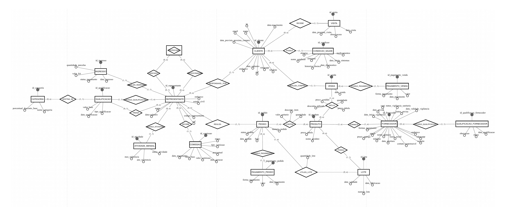

# Entrega 1 — Modelo Conceitual (DER)

## Integrantes

- Breno Troillo Carvalho — RGM: 4797955
- Pablo Ferreira Dos Reis — RGM: 48075353
- Vitoria Rodrigues Alves — RGM: 49993526

## 1. Caracterização da Organização

- **Nome e natureza da organização:**  
  A organização escolhida para o desenvolvimento deste projeto é a **Trattos Comércio de Produtos Naturais**, empreendimento comercial de pequeno porte registrado como Microempreendedor Individual (MEI), sob responsabilidade de **Thomas Araujo Troilo**, inscrito no CNPJ **49.219.067/0001-00**. A empresa atua no segmento de produtos naturais e suplementos alimentares funcionais voltados aos cuidados com a saúde e à qualidade de vida.

  Entre os produtos comercializados encontram-se colágeno hidrolisado, cálcio e magnésio, levedo de cerveja, Allium, pólen apícola, entre outros. A Trattos também trabalha com representantes comerciais organizados em um sistema multinível, que realizam a ponte entre a empresa e os clientes finais.

- **Contexto e porte:**  
  A Trattos possui uma estrutura operacional de pequeno porte. Atualmente, duas pessoas atuam diretamente nas atividades internas da organização: uma responsável pelas funções operacionais, técnicas e administrativas e outra voltada ao atendimento dos representantes, vendas, conferência e entrega dos pedidos.

  Além da estrutura interna, a operação envolve uma rede de representantes responsáveis pela aquisição e comercialização dos produtos, atendimento e acompanhamento de clientes, realização de pedidos e desenvolvimento da rede comercial.

  O ingresso de novos representantes ocorre mediante aquisição de um kit convertido em produtos. Após o ingresso, os representantes podem evoluir de categoria conforme regras comerciais e metas definidas pela organização, além de participar do sistema de comissões e bonificações.

- **Problemas e necessidades identificados:**  
  Durante o levantamento de requisitos foi identificado que a Trattos já utiliza recursos tecnológicos em parte de sua operação. A empresa possui um sistema interno para controle de pedidos e estoque, utiliza a plataforma Bling para emissão de notas fiscais e utiliza o WhatsApp como importante canal de comunicação com os representantes, inclusive para pedidos e envio de comprovantes de pagamento.

  Entretanto, uma das principais dificuldades identificadas está no **controle e pagamento das comissões dos representantes**, processo que atualmente ocorre de maneira semiautomatizada. A existência de diferentes categorias, qualificações, níveis da rede, metas e modalidades de comissão aumenta a necessidade de manter informações organizadas e rastreáveis.

  Também foi identificada a necessidade de centralizar informações atualmente relacionadas a diferentes processos, tais como cadastro e acompanhamento de clientes, histórico de visitas, pedidos, produtos, lotes, estoque, pagamentos, fornecedores, qualificações, vendas, atividade dos representantes e comissões.

  Dessa forma, uma das necessidades apresentadas pela própria organização é a possibilidade de possuir um **escritório virtual para os representantes**, permitindo acompanhar clientes, pedidos, pagamentos, desempenho da equipe, produção e comissões em um ambiente integrado.

- **Justificativa da escolha:**  
  A Trattos foi escolhida por ser uma **organização real e acessível ao grupo para realização da pesquisa de campo**, permitindo que as informações utilizadas no projeto fossem obtidas diretamente com um responsável pela operação.

  A empresa também apresenta um cenário adequado para a aplicação dos conceitos de modelagem de banco de dados estudados na disciplina. Seus processos envolvem diferentes conjuntos de informações relacionadas entre si, incluindo representantes, clientes, categorias, qualificações, produtos, lotes, pedidos, vendas, pagamentos, fornecedores, condições de saúde informadas pelos clientes, visitas e comissões.

  Essa diversidade possibilita desenvolver um modelo conceitual suficientemente abrangente para representar uma operação real, sem a necessidade de criar uma organização fictícia. Além disso, a necessidade identificada de melhorar a organização das informações e o controle das comissões demonstra uma aplicação prática para o banco de dados proposto.

- **Evidências da organização:**  
  A existência e o funcionamento da Trattos foram verificados por meio de informações cadastrais públicas e, principalmente, por **pesquisa de campo realizada através de entrevista com um responsável pela organização**. Durante a entrevista foram coletadas informações sobre produtos, estrutura operacional, representantes, clientes, pedidos, estoque, lotes, pagamentos, fornecedores, qualificações, comissões e necessidades do sistema.

  **Dados cadastrais e de contato da organização:**

  - **Nome comercial:** Trattos Comércio de Produtos Naturais
  - **Responsável / Razão Social:** Thomas Araujo Troilo
  - **Natureza empresarial:** Microempreendedor Individual (MEI)
  - **CNPJ:** 49.219.067/0001-00
  - **Endereço:** Rua Afonso Henriques, 127, Térreo — Vila Santo Estevão / Tatuapé — São Paulo/SP — CEP 03325-120
  - **Telefone:** (11) 2295-9889
  - **WhatsApp comercial:** (11) 97890-0241 / (11) 96916-7492
  - **Instagram oficial:** @trattos.br

  Como evidências complementares, os materiais utilizados no levantamento de requisitos e as respostas obtidas durante a pesquisa de campo são mantidos na pasta `pesquisa` deste repositório.

## 2. Processos de Negócio

Durante o levantamento realizado com a Trattos, foram identificados os seguintes processos principais:

### 2.1 Cadastro e acompanhamento de representantes

O representante ingressa na Trattos mediante aquisição de um kit de ingresso, atualmente no valor de R$ 500,00, convertido em produtos. Após o ingresso, o representante inicia normalmente na categoria R30 e pode evoluir para outras condições comerciais conforme as regras de qualificação da empresa.

O sistema também precisa manter a relação de patrocínio entre os representantes, permitindo identificar quem indicou cada novo integrante e reconstruir a estrutura da rede comercial.

Além disso, deve ser mantido o histórico de evolução do representante, incluindo qualificações, categoria alcançada, atividade mensal e comissões geradas.

### 2.2 Cadastro e acompanhamento de clientes

Cada cliente é cadastrado e permanece vinculado a um representante responsável. Um representante pode atender vários clientes, enquanto cada cliente possui um único representante responsável por vez.

Caso o representante não possa mais realizar o atendimento, o cliente pode ser transferido para outro representante.

O cadastro contempla informações pessoais e de contato, além de dados relevantes para o acompanhamento do cliente, como condições de saúde, previsão de próxima compra e histórico de visitas.

### 2.3 Visitas e acompanhamento dos clientes

Os representantes realizam acompanhamento dos clientes ao longo do relacionamento comercial.

O sistema deve registrar as visitas realizadas, incluindo data, observações e previsão da próxima visita. Dessa forma, torna-se possível manter um histórico do acompanhamento de cada cliente e auxiliar no planejamento dos próximos contatos.

### 2.4 Emissão e acompanhamento de pedidos

Os pedidos são emitidos por meio do sistema utilizado pela empresa. Cada pedido está relacionado a um representante e pode conter um ou mais produtos.

Entre as informações registradas estão número do pedido, data, quantidade, valor unitário, desconto aplicado, frete e os lotes utilizados.

Após a emissão, os produtos são separados e o representante pode retirá-los diretamente na empresa ou recebê-los por envio postal. :chatgpt-content-reference{index="1"}

### 2.5 Controle de estoque e lotes

O controle de estoque é realizado considerando a entrada e a saída física dos produtos.

Na entrada são registrados os lotes, suas datas de fabricação e validade. Na saída, o pedido provoca a baixa correspondente no estoque.

A empresa procura utilizar primeiro os lotes mais antigos, contribuindo para o controle de validade e para uma melhor organização do estoque. :chatgpt-content-reference{index="2"}

Um mesmo pedido pode utilizar mais de um lote, sendo necessário registrar a quantidade retirada de cada lote.

### 2.6 Vendas aos clientes

Os representantes realizam vendas para seus clientes finais.

Em cada venda são registradas informações como cliente, produtos comercializados, quantidade, preço considerado, preço efetivamente vendido, desconto aplicado e data da operação.

O histórico de vendas permite acompanhar as compras realizadas pelos clientes e consultar informações sobre operações anteriores.

### 2.7 Registro de pagamentos

O sistema precisa registrar pagamentos relacionados aos pedidos e às vendas.

Um único pagamento pode ser dividido entre diferentes formas, como Pix, transferência bancária, depósito, dinheiro, débito ou crédito. Por esse motivo, uma mesma operação pode possuir vários registros de pagamento.

O histórico financeiro deve ser preservado para permitir consultas posteriores e garantir rastreabilidade das movimentações.

### 2.8 Qualificação dos representantes

A Trattos possui regras de evolução comercial dos representantes.

O representante normalmente inicia na categoria R30 e pode alcançar a categoria R40 conforme as condições previstas pela empresa, como atingir determinada meta de volume ou realizar ingressos de novos representantes.

A evolução precisa ser registrada historicamente para que seja possível acompanhar quando e de que forma cada representante alcançou determinada categoria.

Em alguns casos, um representante diferente do patrocinador pode atuar como treinador durante o processo de evolução para R40, sendo necessário distinguir os papéis de patrocinador e treinador.

### 2.9 Controle de comissões

O controle de comissões é um dos processos mais relevantes para a organização e também uma das principais dificuldades identificadas durante a pesquisa de campo.

As comissões podem ser geradas por diferentes eventos, como ingresso de novos representantes, evolução de integrantes da equipe e outras regras comerciais da empresa.

Uma mesma ocorrência pode gerar pagamentos para mais de um representante, devendo cada comissão ser registrada separadamente para permitir identificar o beneficiário, o tipo, o percentual, o valor e o status do pagamento.

Atualmente, o pagamento de comissões é realizado de forma semiautomatizada, sendo essa uma das principais necessidades de melhoria indicadas pela Trattos. :chatgpt-content-reference{index="3"}

### 2.10 Atividade mensal e desempenho da rede

O sistema deve permitir acompanhar a atividade dos representantes ao longo dos meses.

Esse acompanhamento é importante porque determinadas vantagens e comissões dependem do cumprimento de condições mensais definidas pela empresa.

Também existe a necessidade de acompanhar produção, desempenho da equipe e valores de comissão associados aos representantes.

### 2.11 Cadastro e acompanhamento de fornecedores

A Trattos trabalha com fornecedores qualificados responsáveis pelo fornecimento dos produtos comercializados.

O cadastro contempla informações comerciais, contatos, documentação, situação perante órgãos reguladores, prazo de entrega, formas de pagamento e histórico de qualificação.

A relação entre fornecedores e produtos deve permitir que um mesmo produto possa estar associado a diferentes fornecedores.

### 2.12 Reposição de estoque e compras de fornecedores

A necessidade de reposição é identificada por meio do acompanhamento do estoque, relatórios semanais e alertas de estoque baixo.

Com base na saída dos produtos, a empresa realiza pedidos aos fornecedores considerando uma estimativa de consumo mensal. :chatgpt-content-reference{index="4"}

### Fluxogramas

Nesta etapa, os fluxogramas foram considerados opcionais conforme a orientação da entrega. Os processos principais foram descritos textualmente e representados no Modelo Conceitual por meio das entidades, relacionamentos e cardinalidades do DER.

## 3. Requisitos do Sistema

Os requisitos apresentados nesta seção foram definidos a partir do levantamento realizado com a Trattos, considerando os processos atuais da organização, as necessidades relatadas pelo responsável e as informações necessárias para o modelo conceitual desenvolvido.

### 3.1 Requisitos Funcionais

Os requisitos funcionais representam as ações e funcionalidades que o sistema deverá disponibilizar aos usuários.

- **RF01 — Cadastrar representantes:**  
  O sistema deve permitir cadastrar representantes com seus dados de identificação, endereço, código de representante, estado civil e data de cadastro.

- **RF02 — Registrar a rede de patrocínio:**  
  O sistema deve permitir registrar qual representante indicou diretamente outro representante, possibilitando reconstruir a estrutura da rede comercial.

- **RF03 — Cadastrar clientes:**  
  O sistema deve permitir cadastrar clientes com seus dados pessoais, de contato e informações necessárias ao acompanhamento.

- **RF04 — Vincular cliente a um representante:**  
  O sistema deve permitir associar cada cliente a um único representante responsável por vez.

- **RF05 — Transferir cliente entre representantes:**  
  O sistema deve permitir transferir a responsabilidade por um cliente para outro representante quando o representante atual não puder mais atendê-lo.

- **RF06 — Consultar clientes:**  
  O sistema deve permitir consultar os clientes cadastrados e visualizar seus dados e históricos relacionados.

- **RF07 — Pesquisar e filtrar clientes:**  
  O sistema deve permitir localizar clientes por diferentes critérios, evitando depender exclusivamente do nome como forma de identificação.

- **RF08 — Editar dados dos clientes:**  
  O sistema deve permitir atualizar as informações cadastrais dos clientes.

- **RF09 — Controlar exclusão e recuperação de clientes:**  
  O sistema deve permitir que clientes excluídos permaneçam disponíveis para recuperação durante um período definido antes de eventual exclusão definitiva.

- **RF10 — Registrar condições de saúde do cliente:**  
  O sistema deve permitir registrar uma ou mais condições de saúde associadas ao cliente, incluindo informações como data de início dos sintomas, data de diagnóstico, sintomas, medicamentos, alergias e histórico da doença.

- **RF11 — Registrar visitas aos clientes:**  
  O sistema deve permitir registrar visitas realizadas aos clientes, contendo data da visita, observações e previsão da próxima visita.

- **RF12 — Registrar previsão de próxima compra:**  
  O sistema deve permitir manter a previsão da próxima compra de cada cliente para auxiliar no acompanhamento comercial.

- **RF13 — Cadastrar produtos:**  
  O sistema deve permitir cadastrar os produtos comercializados pela Trattos e seus respectivos preços de tabela.

- **RF14 — Controlar lotes dos produtos:**  
  O sistema deve permitir cadastrar os lotes dos produtos, incluindo número do lote, data de fabricação e data de validade.

- **RF15 — Consultar estoque:**  
  O sistema deve permitir consultar a disponibilidade dos produtos e lotes existentes no estoque.

- **RF16 — Registrar pedidos:**  
  O sistema deve permitir registrar os pedidos realizados pelos representantes, incluindo número do pedido, data, produtos, quantidades, valores unitários, descontos e frete.

- **RF17 — Adicionar e remover produtos do pedido:**  
  O sistema deve permitir alterar os produtos e quantidades de um pedido enquanto a operação estiver disponível para edição.

- **RF18 — Registrar os lotes utilizados em um pedido:**  
  O sistema deve permitir identificar quais lotes foram utilizados na separação de cada pedido e a quantidade retirada de cada lote.

- **RF19 — Consultar o status dos pedidos:**  
  O sistema deve permitir acompanhar a situação dos pedidos durante seu processamento, separação, retirada ou envio.

- **RF20 — Registrar vendas aos clientes:**  
  O sistema deve permitir registrar as vendas realizadas aos clientes, incluindo produtos, quantidades, preço de tabela considerado, preço efetivamente vendido, desconto aplicado e data da operação.

- **RF21 — Registrar pagamentos de pedidos:**  
  O sistema deve permitir registrar os pagamentos relacionados aos pedidos, contendo data, valor e forma de pagamento.

- **RF22 — Registrar pagamentos de vendas:**  
  O sistema deve permitir registrar os pagamentos relacionados às vendas realizadas aos clientes.

- **RF23 — Permitir pagamentos em múltiplas formas:**  
  O sistema deve permitir que uma mesma operação seja paga utilizando mais de uma forma de pagamento, como parte em dinheiro, parte em Pix e parte em cartão.

- **RF24 — Consultar histórico de pagamentos:**  
  O sistema deve permitir consultar pagamentos realizados anteriormente, preservando o histórico financeiro das operações.

- **RF25 — Registrar ingresso de representantes:**  
  O sistema deve permitir registrar o ingresso de novos representantes, incluindo data de ingresso, valor do kit, quantidade de parcelas e situação do pagamento.

- **RF26 — Registrar qualificações dos representantes:**  
  O sistema deve permitir registrar a evolução dos representantes entre categorias, incluindo a data, o tipo de qualificação e o valor-base relacionado ao processo.

- **RF27 — Registrar categorias dos representantes:**  
  O sistema deve permitir controlar as categorias comerciais existentes, como R30 e R40, juntamente com seus respectivos percentuais de desconto-base.

- **RF28 — Registrar treinador de uma qualificação:**  
  O sistema deve permitir identificar o representante que atuou como treinador durante uma qualificação quando o acompanhamento tiver sido realizado por pessoa diferente do patrocinador.

- **RF29 — Manter histórico de evolução do representante:**  
  O sistema deve permitir consultar o histórico de qualificações e evolução comercial de cada representante.

- **RF30 — Controlar atividade mensal dos representantes:**  
  O sistema deve permitir registrar e consultar a situação mensal dos representantes em relação às condições necessárias para benefícios e comissões.

- **RF31 — Registrar comissões:**  
  O sistema deve permitir registrar individualmente as comissões geradas para cada representante, contendo tipo de comissão, valor-base, percentual, valor da comissão, data de geração, status e data de pagamento.

- **RF32 — Consultar comissões:**  
  O sistema deve permitir que usuários autorizados consultem as comissões geradas, aprovadas e pagas.

- **RF33 — Consultar desempenho e comissões da equipe:**  
  O sistema deve permitir acompanhar informações relacionadas ao desempenho dos representantes e de sua rede comercial.

- **RF34 — Utilizar comissões na compra de produtos:**  
  O sistema deve permitir, conforme as regras da organização, que valores disponíveis de comissão possam ser utilizados na aquisição de produtos.

- **RF35 — Cadastrar fornecedores:**  
  O sistema deve permitir cadastrar fornecedores com informações como CNPJ, razão social, nome fantasia, endereço, data de abertura, contatos, telefone, WhatsApp, e-mail, website, informações regulatórias, prazo de entrega e formas de pagamento.

- **RF36 — Associar fornecedores aos produtos:**  
  O sistema deve permitir relacionar cada produto aos fornecedores responsáveis por seu fornecimento.

- **RF37 — Registrar qualificação de fornecedores:**  
  O sistema deve permitir registrar avaliações e qualificações dos fornecedores ao longo do tempo, contendo data, status e observações.

- **RF38 — Consultar histórico de qualificação dos fornecedores:**  
  O sistema deve permitir acompanhar o histórico das qualificações realizadas para cada fornecedor.

- **RF39 — Acompanhar informações de produção e movimentação:**  
  O sistema deve permitir consultar informações relacionadas à produção comercial, pedidos, vendas e movimentação dos representantes.

### 3.2 Requisitos Não Funcionais

Os requisitos não funcionais representam características de qualidade, segurança, desempenho, confiabilidade e usabilidade que o sistema deverá atender.

- **RNF01 — Segurança dos dados pessoais:**  
  O sistema deve proteger as informações pessoais de clientes e representantes contra acessos não autorizados.

- **RNF02 — Controle de acesso:**  
  Informações sensíveis, financeiras, de clientes e de equipe devem ser acessíveis apenas a usuários autorizados, de acordo com suas responsabilidades.

- **RNF03 — Segurança dos dados financeiros:**  
  Dados relacionados a pagamentos e comissões devem possuir mecanismos de proteção contra alterações indevidas e acessos não autorizados.

- **RNF04 — Integridade dos dados:**  
  O sistema deve garantir a consistência das informações relacionadas a representantes, clientes, pedidos, produtos, lotes, vendas, pagamentos, fornecedores, qualificações e comissões.

- **RNF05 — Preservação do histórico:**  
  Registros financeiros, pagamentos, comissões, qualificações e demais informações históricas relevantes não devem ser apagados de forma que prejudique a rastreabilidade das operações.

- **RNF06 — Desempenho:**  
  Consultas, pesquisas, filtros e carregamento das principais informações devem ocorrer em tempo adequado para não prejudicar o atendimento e as atividades da organização.

- **RNF07 — Usabilidade:**  
  As interfaces de cadastro, consulta, pesquisa e acompanhamento devem ser simples e intuitivas para os usuários autorizados.

- **RNF08 — Precisão nas pesquisas:**  
  As buscas devem apresentar resultados compatíveis com os critérios informados, inclusive quando existirem clientes com nomes iguais.

- **RNF09 — Identificação única dos registros:**  
  O sistema não deve utilizar apenas o nome como forma de identificação única de clientes, representantes ou demais registros que possam possuir valores repetidos.

- **RNF10 — Precisão financeira:**  
  Valores relacionados a pagamentos, descontos e comissões devem ser armazenados e apresentados com precisão adequada às operações financeiras.

- **RNF11 — Consistência do estoque:**  
  Entradas e saídas de produtos devem manter as informações de estoque e lotes atualizadas, reduzindo divergências entre o estoque registrado e o estoque físico.

- **RNF12 — Controle de validade:**  
  As informações de fabricação e validade dos lotes devem permanecer disponíveis para auxiliar no controle da saída dos produtos.

- **RNF13 — Rastreabilidade:**  
  O sistema deve manter informações suficientes para identificar a origem e o histórico de operações relevantes, como pedidos, pagamentos, qualificações e comissões.

- **RNF14 — Recuperação de informações:**  
  Registros de clientes excluídos por engano devem possuir possibilidade de recuperação conforme a política definida pela organização.

- **RNF15 — Atualização das informações:**  
  Informações relacionadas a pedidos, estoque, pagamentos e comissões devem refletir os registros mais recentes disponíveis no sistema.

- **RNF16 — Escalabilidade:**  
  O modelo de dados deve permitir o crescimento da quantidade de representantes, clientes, produtos, fornecedores, pedidos, vendas e registros históricos sem exigir alterações significativas em sua estrutura conceitual.

- **RNF17 — Confidencialidade das informações de saúde:**  
  Dados relacionados às condições de saúde dos clientes devem possuir acesso restrito e tratamento compatível com seu caráter sensível.

- **RNF18 — Disponibilidade dos históricos financeiros:**  
  O histórico de pagamentos e demais registros financeiros relevantes deve permanecer disponível para consultas posteriores, não devendo desaparecer automaticamente com o passar do tempo.

## 4. Regras de Negócio

As regras de negócio abaixo foram definidas a partir das informações obtidas junto à Trattos e representam condições reais de funcionamento da organização que influenciam diretamente a estrutura do banco de dados.

### 4.1 Regras Operacionais

- **RN01 — Responsabilidade sobre clientes:**  
  Um representante pode ser responsável por vários clientes, enquanto cada cliente deve possuir apenas um representante responsável por vez.

- **RN02 — Transferência de clientes:**  
  Quando um representante não puder mais atender determinado cliente, a responsabilidade pode ser transferida para outro representante.

- **RN03 — Identificação dos clientes:**  
  O nome não deve ser utilizado como identificador único, pois podem existir clientes com o mesmo nome. Cada cliente deve possuir um identificador próprio no sistema.

- **RN04 — Condições de saúde do cliente:**  
  Um cliente pode possuir nenhuma, uma ou várias condições de saúde registradas. Cada condição pode conter informações sobre início dos sintomas, diagnóstico, sintomas, medicamentos, alergias e histórico da doença.

- **RN05 — Histórico de visitas:**  
  Um cliente pode possuir várias visitas registradas ao longo do tempo. Cada visita pertence a um único cliente e deve permitir o registro de data, observações e previsão de próxima visita.

- **RN06 — Ingresso do representante:**  
  Cada representante realiza um único ingresso na Trattos. O ingresso ocorre mediante aquisição de um kit, atualmente no valor de R$ 500,00, convertido em produtos.

- **RN07 — Categoria inicial do representante:**  
  Ao ingressar, o representante inicia normalmente na categoria R30.

- **RN08 — Evolução de categoria:**  
  O representante pode evoluir para a categoria R40 conforme as regras de qualificação adotadas pela Trattos.

- **RN09 — Histórico de qualificação:**  
  As qualificações dos representantes devem ser mantidas historicamente, permitindo identificar quando e por qual regra uma evolução de categoria ocorreu.

- **RN10 — Patrocínio direto:**  
  Um representante pode possuir no máximo um patrocinador direto. Um patrocinador pode indicar nenhum, um ou vários representantes.

- **RN11 — Estrutura da rede:**  
  A rede comercial deve ser reconstruída a partir das relações de patrocínio direto, não sendo necessário armazenar explicitamente informações como “filho”, “neto”, “primeiro nível” ou “segundo nível”.

- **RN12 — Distinção entre patrocinador e treinador:**  
  O representante que indicou uma pessoa e o representante que realizou seu treinamento podem ser pessoas diferentes.

- **RN13 — Treinamento na qualificação:**  
  Uma qualificação pode ocorrer sem treinador específico ou possuir no máximo um representante registrado como treinador.

- **RN14 — Atividade mensal:**  
  A situação mensal do representante deve ser controlada separadamente de sua categoria. O não cumprimento de uma meta mensal não elimina automaticamente uma categoria já alcançada.

- **RN15 — Distinção entre desconto e comissão:**  
  O desconto comercial concedido ao representante não deve ser tratado como comissão. O desconto representa uma redução no preço de compra, enquanto a comissão é um valor gerado por regras específicas da rede.

- **RN16 — Comissão individualizada:**  
  Cada comissão deve ser registrada separadamente para o respectivo beneficiário, mesmo quando um mesmo evento gera valores para mais de um representante.

- **RN17 — Registro de comissão:**  
  Cada comissão deve possuir informações que permitam identificar seu tipo, valor-base, percentual, valor calculado, data de geração, situação e data de pagamento.

- **RN18 — Preservação das comissões:**  
  Registros de comissão não devem ser simplesmente apagados quando houver cancelamento ou correção, pois o histórico financeiro precisa ser preservado.

- **RN19 — Pedidos:**  
  Cada pedido pertence a um único representante e deve conter pelo menos um produto.

- **RN20 — Produtos no pedido:**  
  Um pedido pode conter vários produtos e um mesmo produto pode aparecer em vários pedidos.

- **RN21 — Informações por produto no pedido:**  
  Para cada produto incluído em um pedido devem ser registradas informações como quantidade, valor unitário e desconto aplicado.

- **RN22 — Lotes dos produtos:**  
  Cada lote pertence a um único produto, enquanto um produto pode possuir vários lotes ao longo do tempo.

- **RN23 — Utilização de lotes nos pedidos:**  
  Um pedido pode utilizar um ou mais lotes, inclusive mais de um lote para atender a quantidade de um mesmo produto.

- **RN24 — Quantidade utilizada por lote:**  
  A quantidade retirada de cada lote em um pedido deve ser registrada separadamente.

- **RN25 — Saída por lote mais antigo:**  
  Na separação dos produtos, a empresa procura utilizar primeiro os lotes mais antigos, respeitando o controle de fabricação e validade.

- **RN26 — Baixa de estoque:**  
  A saída dos produtos do estoque ocorre a partir dos pedidos registrados.

- **RN27 — Venda ao cliente:**  
  Cada venda pertence a um único cliente e deve possuir pelo menos um produto.

- **RN28 — Produtos na venda:**  
  Para cada produto incluído em uma venda devem ser registradas informações como quantidade, preço de tabela considerado, preço efetivamente vendido e desconto aplicado.

- **RN29 — Histórico de vendas:**  
  As informações das vendas devem ser preservadas para permitir consultas posteriores sobre compras realizadas pelos clientes.

- **RN30 — Pagamentos fracionados:**  
  Uma mesma operação pode ser paga utilizando mais de uma forma de pagamento.

- **RN31 — Formas de pagamento:**  
  Entre as formas aceitas podem existir Pix, transferência bancária, TED, DOC, depósito, dinheiro, débito, crédito à vista e crédito parcelado.

- **RN32 — Pagamentos de pedidos:**  
  Um pedido pode ainda não possuir pagamento registrado ou possuir vários registros de pagamento.

- **RN33 — Pagamentos de vendas:**  
  Uma venda pode ainda não possuir pagamento registrado ou possuir vários registros de pagamento.

- **RN34 — Histórico de pagamentos:**  
  Os registros de pagamento devem ser mantidos para consulta e rastreabilidade, não devendo desaparecer automaticamente com o passar do tempo.

- **RN35 — Fornecedores:**  
  A Trattos pode trabalhar com vários fornecedores, e um mesmo produto pode estar relacionado a mais de um fornecedor.

- **RN36 — Cadastro de fornecedores:**  
  O cadastro de fornecedores deve contemplar informações comerciais, contatos, situação regulatória, prazo de entrega e formas de pagamento.

- **RN37 — Qualificação de fornecedores:**  
  As avaliações e qualificações dos fornecedores devem possuir histórico próprio, contendo data, status e observações.

- **RN38 — Controle regulatório:**  
  Informações relacionadas à ANVISA e à Vigilância Sanitária devem ser registradas quando aplicáveis ao fornecedor.

- **RN39 — Reposição de estoque:**  
  A necessidade de compra junto aos fornecedores pode ser identificada por meio de relatórios periódicos, alertas de estoque baixo e análise da saída dos produtos.

- **RN40 — Consulta de equipe e comissões:**  
  Informações sobre desempenho da equipe e comissões devem ser acessíveis apenas a usuários autorizados.

### 4.2 Restrições Organizacionais

- **RO01 — Proteção de dados pessoais:**  
  Informações pessoais de clientes e representantes devem possuir acesso controlado e ser utilizadas apenas para fins compatíveis com a operação da empresa.

- **RO02 — Proteção de dados de saúde:**  
  Informações relacionadas às condições de saúde dos clientes possuem caráter sensível e devem ter acesso restrito.

- **RO03 — Preservação de histórico financeiro:**  
  Pagamentos, comissões e demais registros financeiros relevantes devem ser mantidos para garantir rastreabilidade das operações.

- **RO04 — Integridade das informações de estoque:**  
  Alterações em pedidos e movimentações devem preservar a consistência entre produtos, lotes e estoque físico.

- **RO05 — Controle de validade:**  
  As datas de fabricação e validade dos lotes devem ser preservadas para permitir o controle adequado da saída dos produtos.

- **RO06 — Controle de acesso por responsabilidade:**  
  Usuários do sistema devem visualizar apenas as informações compatíveis com suas funções e autorizações.

- **RO07 — Histórico de evolução da rede:**  
  Mudanças de categoria, qualificação e atividade mensal dos representantes devem ser mantidas historicamente para permitir acompanhamento de sua evolução.

- **RO08 — Regras de comissão sujeitas à validação comercial:**  
  Como existem diferentes modalidades de comissão, bonificação e qualificação na Trattos, regras financeiras específicas devem ser validadas antes de qualquer implementação automática de cálculo.

- **RO09 — Separação entre informações derivadas e registradas:**  
  Sempre que uma informação puder ser obtida de forma confiável a partir de dados já registrados, deve-se evitar sua duplicação desnecessária no banco, reduzindo risco de inconsistência.

- **RO10 — Consistência do modelo conceitual:**  
  Relacionamentos redundantes devem ser evitados quando a mesma informação puder ser obtida por outro relacionamento já existente no modelo, exceto quando cada relacionamento representar um fato de negócio distinto.

## 5. Dicionário de Dados Conceitual (Preliminar)

O dicionário de dados a seguir descreve as entidades e atributos identificados no modelo conceitual da Trattos. As descrições foram elaboradas a partir do levantamento realizado com a organização e das regras de negócio definidas para o projeto.

### 5.1 REPRESENTANTE

| Atributo | Descrição | Regra de negócio associada |
|----------|-----------|-----------------------------|
| id_representante | Identificador único do representante. | Deve identificar unicamente cada representante no sistema. |
| nome | Nome do representante. | Utilizado para identificação e consulta. |
| cpf | CPF do representante. | Deve estar associado ao cadastro do representante. |
| codigo_representante | Código utilizado pela Trattos para identificar comercialmente o representante. | Cada representante possui seu código de identificação na operação. |
| data_cadastro | Data em que o representante foi cadastrado. | Permite identificar o início de seu vínculo com a organização. |
| endereco | Endereço do representante. | Informação utilizada no cadastro comercial. |
| estado_civil | Estado civil informado no cadastro. | Informação cadastral do representante. |

### 5.2 CLIENTE

| Atributo | Descrição | Regra de negócio associada |
|----------|-----------|-----------------------------|
| id_cliente | Identificador único do cliente. | O nome não deve ser utilizado como identificador único, pois clientes diferentes podem possuir o mesmo nome. |
| nome | Nome do cliente. | Informação utilizada para identificação e atendimento. |
| cpf | CPF do cliente. | Informação cadastral pessoal. |
| rg | Documento de identidade do cliente. | Informação cadastral pessoal. |
| data_nascimento | Data de nascimento do cliente. | Utilizada no cadastro do cliente. |
| endereco | Endereço do cliente. | Informação necessária para cadastro e atendimento. |
| telefone | Número de telefone do cliente. | Meio de contato. |
| whatsapp | Número utilizado pelo cliente no WhatsApp. | Meio de contato utilizado no acompanhamento comercial. |
| email | Endereço eletrônico do cliente. | Meio de contato. |
| data_cadastro | Data em que o cliente foi inserido no sistema. | Permite acompanhar o histórico do relacionamento com a empresa. |
| data_prevista_proxima_compra | Previsão da próxima compra do cliente. | Utilizada para auxiliar no acompanhamento comercial. |

### 5.3 CATEGORIA

| Atributo | Descrição | Regra de negócio associada |
|----------|-----------|-----------------------------|
| id_categoria | Identificador único da categoria. | Deve identificar cada categoria comercial existente. |
| nome_categoria | Nome da categoria comercial, como R30 ou R40. | O representante inicia normalmente como R30 e pode evoluir conforme regras de qualificação. |
| percentual_desconto_base | Percentual básico de desconto associado à categoria. | R30 e R40 possuem condições comerciais distintas. |

### 5.4 QUALIFICACAO

| Atributo | Descrição | Regra de negócio associada |
|----------|-----------|-----------------------------|
| id_qualificacao | Identificador único da qualificação. | Cada evento de qualificação deve possuir seu próprio registro. |
| data_qualificacao | Data em que a qualificação ocorreu. | Permite manter o histórico de evolução do representante. |
| tipo_qualificacao | Forma pela qual a qualificação foi alcançada. | A Trattos possui mais de uma modalidade de progressão para categorias superiores. |
| valor_base | Valor considerado para determinada regra de qualificação. | Deve representar a base utilizada no processo, quando aplicável. |

### 5.5 INGRESSO

| Atributo | Descrição | Regra de negócio associada |
|----------|-----------|-----------------------------|
| id_ingresso | Identificador único do ingresso. | Cada representante possui um único ingresso registrado. |
| data_ingresso | Data de entrada do representante na Trattos. | Marca o início formal de sua participação na rede. |
| valor_kit | Valor do kit adquirido para ingresso. | O ingresso ocorre mediante aquisição do kit definido pela empresa. |
| quantidade_parcelas | Quantidade de parcelas utilizadas no pagamento do ingresso. | O kit pode possuir condições de parcelamento definidas pela empresa. |
| status_pagamento | Situação do pagamento do ingresso. | Permite acompanhar se o ingresso está quitado ou pendente. |

### 5.6 ATIVIDADE_MENSAL

| Atributo | Descrição | Regra de negócio associada |
|----------|-----------|-----------------------------|
| id_atividade | Identificador único do registro mensal. | Cada período acompanhado deve possuir seu próprio registro. |
| mes_referencia | Mês ao qual a atividade se refere. | A avaliação de atividade ocorre por período mensal. |
| ano_referencia | Ano correspondente ao período de atividade. | Utilizado junto ao mês para identificar o período. |
| status_atividade | Situação do representante naquele período. | A situação mensal é independente da categoria já alcançada. |

### 5.7 COMISSAO

| Atributo | Descrição | Regra de negócio associada |
|----------|-----------|-----------------------------|
| id_comissao | Identificador único da comissão. | Cada comissão deve ser registrada separadamente. |
| tipo_comissao | Identifica a modalidade da comissão gerada. | A Trattos possui diferentes tipos de comissão e bonificação. |
| valor_base | Valor utilizado como base para o cálculo. | Pode variar de acordo com o evento que gerou a comissão. |
| percentual | Percentual aplicado sobre o valor-base. | Depende da modalidade de comissão. |
| valor_comissao | Valor monetário da comissão calculada. | Deve corresponder ao lançamento individual de um beneficiário. |
| data_geracao | Data em que a comissão foi gerada. | Permite manter rastreabilidade financeira. |
| status | Situação atual da comissão. | Pode representar etapas como geração, aprovação, pagamento ou cancelamento. |
| data_pagamento | Data em que a comissão foi efetivamente paga. | Pode permanecer sem preenchimento enquanto a comissão não estiver paga. |

### 5.8 VISITA

| Atributo | Descrição | Regra de negócio associada |
|----------|-----------|-----------------------------|
| id_visita | Identificador único da visita. | Cada visita deve possuir registro próprio. |
| data_visita | Data em que a visita ocorreu. | Permite formar o histórico de atendimento do cliente. |
| observacoes | Informações registradas durante ou após a visita. | Utilizadas no acompanhamento do cliente. |
| data_proxima_visita | Data prevista para o próximo acompanhamento. | Auxilia no planejamento dos próximos contatos. |

### 5.9 CONDICAO_SAUDE

| Atributo | Descrição | Regra de negócio associada |
|----------|-----------|-----------------------------|
| id_condicao | Identificador único da condição de saúde registrada. | Um cliente pode possuir várias condições registradas. |
| nome_condicao | Nome ou identificação da condição de saúde. | Diferencia as condições registradas para o mesmo cliente. |
| data_inicio_sintomas | Data aproximada de início dos sintomas. | Informação relatada para acompanhamento. |
| data_diagnostico | Data em que ocorreu o diagnóstico, quando conhecida. | Pode não existir em todas as condições. |
| sintomas | Sintomas relacionados à condição. | Uma condição pode apresentar mais de um sintoma. |
| medicamentos | Medicamentos relacionados ao tratamento ou acompanhamento. | Pode conter mais de um medicamento. |
| alergias | Alergias relevantes informadas pelo cliente. | Deve permitir registrar mais de uma ocorrência quando necessário. |
| historico_doenca | Histórico relacionado à condição de saúde. | Utilizado para manter contexto do acompanhamento do cliente. |

### 5.10 PEDIDO

| Atributo | Descrição | Regra de negócio associada |
|----------|-----------|-----------------------------|
| id_pedido | Identificador único do pedido. | Cada pedido deve ser identificado individualmente. |
| numero_pedido | Número comercial utilizado para identificar o pedido. | Utilizado para consultas e acompanhamento operacional. |
| data_pedido | Data em que o pedido foi realizado. | Necessária para histórico e controle das operações. |
| frete | Valor ou informação relacionada ao frete. | Aplicável quando houver envio do pedido. |
| status_pedido | Situação atual do pedido. | Permite acompanhar processamento, separação, retirada ou envio. |

### 5.11 PAGAMENTO_PEDIDO

| Atributo | Descrição | Regra de negócio associada |
|----------|-----------|-----------------------------|
| id_pagamento_pedido | Identificador único do pagamento relacionado a pedido. | Cada parcela ou forma utilizada deve possuir registro próprio. |
| data_pagamento | Data em que o pagamento ocorreu. | Necessária para histórico financeiro. |
| valor | Valor pago naquele registro. | Um pedido pode possuir vários pagamentos. |
| forma_pagamento | Forma utilizada no pagamento. | Uma mesma operação pode utilizar diferentes formas de pagamento. |

### 5.12 PRODUTO

| Atributo | Descrição | Regra de negócio associada |
|----------|-----------|-----------------------------|
| id_produto | Identificador único do produto. | Deve identificar individualmente cada produto cadastrado. |
| nome_produto | Nome do produto comercializado. | Utilizado em consultas, pedidos e vendas. |
| preco_tabela | Preço de tabela atual do produto. | Serve como referência para descontos e operações comerciais. |

### 5.13 LOTE

| Atributo | Descrição | Regra de negócio associada |
|----------|-----------|-----------------------------|
| id_lote | Identificador único do lote. | Cada lote deve possuir registro próprio. |
| numero_lote | Número atribuído ao lote do produto. | Utilizado para rastreabilidade. |
| data_fabricacao | Data de fabricação do lote. | Utilizada no controle dos produtos. |
| data_validade | Data de validade do lote. | Deve ser considerada no controle de saída e validade do estoque. |

### 5.14 VENDA

| Atributo | Descrição | Regra de negócio associada |
|----------|-----------|-----------------------------|
| id_venda | Identificador único da venda. | Cada venda realizada deve possuir registro próprio. |
| data_venda | Data em que a venda ocorreu. | Utilizada para consulta do histórico de compras do cliente. |

### 5.15 PAGAMENTO_VENDA

| Atributo | Descrição | Regra de negócio associada |
|----------|-----------|-----------------------------|
| id_pagamento_venda | Identificador único do pagamento da venda. | Cada pagamento deve ser registrado individualmente. |
| data_pagamento | Data em que o pagamento ocorreu. | Necessária para histórico financeiro. |
| valor | Valor recebido naquele pagamento. | Uma venda pode ser dividida em vários pagamentos. |
| forma_pagamento | Forma utilizada para realizar o pagamento. | Uma venda pode utilizar diferentes formas de pagamento. |

### 5.16 FORNECEDOR

| Atributo | Descrição | Regra de negócio associada |
|----------|-----------|-----------------------------|
| id_fornecedor | Identificador único do fornecedor. | Deve identificar individualmente cada fornecedor cadastrado. |
| cnpj | CNPJ do fornecedor. | Informação cadastral da empresa fornecedora. |
| razao_social | Razão social do fornecedor. | Informação comercial e cadastral. |
| nome_fantasia | Nome fantasia utilizado pelo fornecedor. | Informação comercial. |
| endereco | Endereço do fornecedor. | Utilizado no cadastro comercial. |
| data_abertura | Data de abertura da empresa fornecedora. | Informação cadastral. |
| contato_responsavel | Nome ou identificação da pessoa de contato. | Utilizado na comunicação comercial. |
| telefone | Telefone do fornecedor. | Meio de contato. |
| whatsapp | Número de WhatsApp do fornecedor. | Meio de contato comercial. |
| email | Endereço eletrônico do fornecedor. | Meio de contato comercial. |
| website | Endereço do site do fornecedor. | Informação comercial quando existente. |
| status_anvisa | Situação relacionada à ANVISA. | Utilizada no acompanhamento regulatório do fornecedor. |
| data_anvisa | Data relacionada ao registro ou verificação da situação perante a ANVISA. | Permite acompanhar a atualização da informação regulatória. |
| status_vigilancia_sanitaria | Situação perante a Vigilância Sanitária. | Informação utilizada na qualificação do fornecedor. |
| data_inicio_vigilancia | Data inicial relacionada à situação sanitária. | Utilizada no acompanhamento documental. |
| data_validade_vigilancia | Data de validade da documentação sanitária. | Auxilia no controle da regularidade do fornecedor. |
| prazo_entrega | Prazo esperado para fornecimento dos produtos. | Utilizado no planejamento de reposição. |
| formas_pagamento | Formas de pagamento aceitas pelo fornecedor. | Um fornecedor pode aceitar mais de uma forma de pagamento. |

### 5.17 QUALIFICACAO_FORNECEDOR

| Atributo | Descrição | Regra de negócio associada |
|----------|-----------|-----------------------------|
| id_qualificacao_fornecedor | Identificador único da avaliação do fornecedor. | Cada avaliação deve possuir registro próprio. |
| data_qualificacao | Data em que a qualificação foi realizada. | Permite construir histórico das avaliações. |
| status | Resultado ou situação obtida na avaliação. | Representa a condição do fornecedor naquele momento. |
| observacao | Observações relacionadas à avaliação. | Utilizadas para registrar informações relevantes sobre a qualificação. |

### 5.18 Atributos dos Relacionamentos

Além dos atributos pertencentes diretamente às entidades, alguns dados do modelo conceitual pertencem aos próprios relacionamentos, pois descrevem características específicas da associação entre duas entidades.

#### CONTEM — PEDIDO e PRODUTO

| Atributo | Descrição | Regra de negócio associada |
|----------|-----------|-----------------------------|
| quantidade | Quantidade do produto incluída no pedido. | Um pedido deve possuir pelo menos um produto. |
| valor_unitario | Valor unitário considerado para aquele produto no pedido. | Deve representar o valor da operação no momento do pedido. |
| desconto_item | Desconto aplicado especificamente ao produto naquele pedido. | Pode variar conforme as condições comerciais. |

#### UTILIZA_LOTE — PEDIDO e LOTE

| Atributo | Descrição | Regra de negócio associada |
|----------|-----------|-----------------------------|
| quantidade_lote | Quantidade retirada de determinado lote para atender o pedido. | Um pedido pode utilizar mais de um lote, inclusive do mesmo produto. |

#### INCLUI — VENDA e PRODUTO

| Atributo | Descrição | Regra de negócio associada |
|----------|-----------|-----------------------------|
| quantidade | Quantidade do produto vendida ao cliente. | Toda venda deve possuir pelo menos um produto. |
| preco_tabela | Preço de tabela considerado no momento daquela venda. | Deve preservar a referência comercial utilizada na operação. |
| preco_vendido | Preço efetivamente praticado na venda. | Pode ser diferente do preço de tabela. |
| desconto_aplicado | Desconto aplicado ao produto na venda. | Deve representar a condição efetivamente concedida na operação. |

**Observação sobre privacidade:** não são utilizados neste dicionário exemplos contendo nomes, documentos, endereços, telefones ou demais dados pessoais reais de clientes, representantes ou responsáveis da organização. Caso sejam necessários exemplos de valores em etapas futuras, serão utilizados apenas dados fictícios.

## 6. Modelagem Conceitual (Entidades, Atributos, Relacionamentos)

A modelagem conceitual foi construída a partir das informações obtidas durante a pesquisa de campo realizada com a Trattos. O objetivo foi representar os principais dados da organização, seus relacionamentos e as regras necessárias para manter consistência e evitar redundâncias desnecessárias.

O modelo foi desenvolvido no BRModelo, utilizando entidades, atributos, relacionamentos e cardinalidades compatíveis com os processos identificados na empresa.

### 6.1 Entidades Reconhecidas

Foram identificadas as seguintes entidades principais:

- **REPRESENTANTE:** representa as pessoas que atuam comercialmente junto à Trattos, realizando pedidos, acompanhando clientes, participando da rede de patrocínio e podendo receber comissões.

- **CLIENTE:** representa os clientes finais atendidos pelos representantes. Cada cliente permanece sob responsabilidade de um representante por vez.

- **CATEGORIA:** representa as categorias comerciais existentes na rede, como R30 e R40, incluindo o percentual de desconto-base correspondente.

- **QUALIFICACAO:** representa os eventos de evolução dos representantes entre categorias, permitindo registrar historicamente quando e como cada progressão ocorreu.

- **INGRESSO:** representa a entrada formal de um novo representante na Trattos, incluindo informações relacionadas ao kit adquirido e ao pagamento realizado.

- **ATIVIDADE_MENSAL:** representa a situação do representante em determinado mês, permitindo separar sua categoria permanente de sua condição de atividade em um período específico.

- **COMISSAO:** representa cada lançamento de comissão gerado para um representante beneficiário.

- **VISITA:** representa as visitas e acompanhamentos realizados junto aos clientes, mantendo datas, observações e previsão de próximos contatos.

- **CONDICAO_SAUDE:** representa as condições de saúde informadas pelos clientes durante o acompanhamento, incluindo sintomas, medicamentos, alergias e histórico relacionado.

- **PEDIDO:** representa os pedidos realizados pelos representantes junto à Trattos.

- **PAGAMENTO_PEDIDO:** representa cada ocorrência de pagamento associada a um pedido, possibilitando registrar pagamentos realizados por diferentes formas.

- **PRODUTO:** representa os produtos comercializados pela Trattos.

- **LOTE:** representa os lotes físicos dos produtos, permitindo controlar fabricação, validade e utilização nos pedidos.

- **VENDA:** representa as vendas de produtos realizadas aos clientes finais.

- **PAGAMENTO_VENDA:** representa os pagamentos associados às vendas realizadas aos clientes.

- **FORNECEDOR:** representa as empresas responsáveis pelo fornecimento dos produtos comercializados pela Trattos.

- **QUALIFICACAO_FORNECEDOR:** representa o histórico de avaliações e qualificações realizadas sobre os fornecedores.

### 6.2 Atributos e Classificações

Os atributos foram definidos conforme a função que exercem no modelo.

#### Atributos identificadores

Cada entidade possui um atributo identificador próprio, como:

- `id_representante`
- `id_cliente`
- `id_categoria`
- `id_qualificacao`
- `id_ingresso`
- `id_atividade`
- `id_comissao`
- `id_visita`
- `id_condicao`
- `id_pedido`
- `id_pagamento_pedido`
- `id_produto`
- `id_lote`
- `id_venda`
- `id_pagamento_venda`
- `id_fornecedor`
- `id_qualificacao_fornecedor`

Esses identificadores permitem distinguir individualmente cada ocorrência das entidades, evitando utilizar atributos como nome como chave principal.

#### Atributos cadastrais

São utilizados para representar informações de identificação e contato, como:

- nome;
- CPF;
- RG;
- endereço;
- telefone;
- WhatsApp;
- e-mail;
- CNPJ;
- razão social;
- nome fantasia;
- website.

#### Atributos temporais

Permitem registrar quando eventos e situações ocorreram, como:

- data de cadastro;
- data de ingresso;
- data da qualificação;
- data da visita;
- data do pedido;
- data da venda;
- data do pagamento;
- data de fabricação;
- data de validade;
- datas relacionadas à situação regulatória dos fornecedores.

#### Atributos financeiros e comerciais

Representam valores utilizados nas operações da Trattos, como:

- preço de tabela;
- valor do kit;
- frete;
- valor de pagamento;
- valor-base da comissão;
- percentual de comissão;
- valor da comissão;
- percentual de desconto-base.

#### Atributos de situação e histórico

Permitem representar estados e evolução ao longo do tempo, como:

- status do pedido;
- status de pagamento;
- status da comissão;
- status de atividade mensal;
- status da qualificação do fornecedor.

Algumas informações pertencem aos próprios relacionamentos e não diretamente às entidades.

No relacionamento entre **PEDIDO** e **PRODUTO** são registrados:

- quantidade;
- valor unitário;
- desconto aplicado.

No relacionamento entre **PEDIDO** e **LOTE** é registrada:

- quantidade utilizada de cada lote.

No relacionamento entre **VENDA** e **PRODUTO** são registrados:

- quantidade;
- preço de tabela considerado na venda;
- preço efetivamente vendido;
- desconto aplicado.

Essa decisão evita criar entidades intermediárias sem significado próprio no modelo conceitual, como `ITEM_PEDIDO` ou `ITEM_VENDA`.

### 6.3 Relacionamentos Pertinentes

Os principais relacionamentos definidos no modelo são:

- **REPRESENTANTE — RESPONSAVEL_POR — CLIENTE:**  
  representa qual representante é responsável pelo atendimento de cada cliente.

- **REPRESENTANTE — PATROCINA — REPRESENTANTE:**  
  autorrelacionamento que representa quem indicou diretamente quem dentro da rede comercial.

- **REPRESENTANTE — POSSUI_QUALIFICACAO — QUALIFICACAO:**  
  registra o histórico de evolução comercial de cada representante.

- **QUALIFICACAO — DESTINA_SE — CATEGORIA:**  
  identifica para qual categoria determinado evento de qualificação levou o representante.

- **REPRESENTANTE — TREINA — QUALIFICACAO:**  
  permite identificar quando outro representante atuou como treinador em determinado processo de qualificação.

- **REPRESENTANTE — REALIZA_INGRESSO — INGRESSO:**  
  associa cada representante ao seu evento de entrada na Trattos.

- **REPRESENTANTE — POSSUI_ATIVIDADE — ATIVIDADE_MENSAL:**  
  registra a situação mensal do representante.

- **REPRESENTANTE — RECEBE — COMISSAO:**  
  associa cada lançamento de comissão ao seu beneficiário.

- **REPRESENTANTE — REALIZA — PEDIDO:**  
  indica qual representante realizou determinado pedido.

- **PEDIDO — CONTEM — PRODUTO:**  
  identifica os produtos presentes em cada pedido.

- **PRODUTO — POSSUI — LOTE:**  
  indica a qual produto cada lote pertence.

- **PEDIDO — UTILIZA_LOTE — LOTE:**  
  registra quais lotes foram efetivamente utilizados na separação de um pedido.

- **PEDIDO — POSSUI_PAGAMENTO — PAGAMENTO_PEDIDO:**  
  registra os pagamentos realizados em relação ao pedido.

- **CLIENTE — REALIZA_COMPRA — VENDA:**  
  associa cada venda ao cliente responsável pela compra.

- **VENDA — INCLUI — PRODUTO:**  
  registra os produtos efetivamente vendidos ao cliente.

- **VENDA — POSSUI_PAGAMENTO — PAGAMENTO_VENDA:**  
  representa os pagamentos realizados para cada venda.

- **CLIENTE — RECEBE — VISITA:**  
  mantém o histórico de visitas e acompanhamento do cliente.

- **CLIENTE — POSSUI — CONDICAO_SAUDE:**  
  registra as condições de saúde relacionadas ao cliente.

- **FORNECEDOR — FORNECE — PRODUTO:**  
  representa os produtos fornecidos por cada fornecedor.

- **FORNECEDOR — POSSUI_QUALIFICACAO — QUALIFICACAO_FORNECEDOR:**  
  mantém o histórico das avaliações dos fornecedores.

### 6.4 Restrições e Políticas Aplicadas ao Modelo

Durante a construção do modelo conceitual foram adotadas algumas decisões com o objetivo de preservar a consistência e reduzir redundâncias.

#### Um representante responsável por vários clientes

Um representante pode ser responsável por nenhum ou vários clientes, enquanto cada cliente deve possuir exatamente um representante responsável por vez.

Essa regra também permite que a responsabilidade seja transferida quando necessário.

#### Rede baseada no patrocinador direto

O modelo armazena somente a relação entre um representante e seu patrocinador direto.

Não são armazenados campos específicos como “filho”, “neto”, “primeiro nível” ou “segundo nível”, pois essas posições podem ser determinadas percorrendo a estrutura de patrocínio.

#### Categoria obtida pelo histórico de qualificação

A categoria do representante não foi armazenada diretamente como atributo da entidade REPRESENTANTE.

A evolução é representada por registros em QUALIFICACAO associados a CATEGORIA, permitindo preservar o histórico e evitando duplicação de informação.

#### Separação entre categoria e atividade mensal

A categoria alcançada pelo representante e sua situação mensal são conceitos diferentes.

Por esse motivo, ATIVIDADE_MENSAL foi mantida separada de CATEGORIA e QUALIFICACAO.

#### Comissão separada do desconto comercial

Percentuais de desconto comercial não foram armazenados como comissão do representante.

As comissões possuem entidade própria, pois representam valores gerados por eventos da rede, enquanto descontos correspondem às condições comerciais de aquisição de produtos.

#### Ausência de ITEM_PEDIDO e ITEM_VENDA

No modelo conceitual não foram criadas entidades `ITEM_PEDIDO` e `ITEM_VENDA`.

As associações N:N entre pedidos e produtos e entre vendas e produtos foram representadas diretamente por relacionamentos que possuem seus próprios atributos.

Essa decisão mantém o modelo no nível conceitual e evita antecipar estruturas típicas do modelo lógico.

#### Relação entre pedidos, produtos e lotes

Foram mantidos relacionamentos distintos entre:

- PEDIDO e PRODUTO;
- PRODUTO e LOTE;
- PEDIDO e LOTE.

Apesar de formar um ciclo visual, cada relacionamento representa um fato de negócio diferente.

O relacionamento entre PEDIDO e PRODUTO informa quais produtos foram solicitados e suas condições comerciais.

O relacionamento entre PRODUTO e LOTE informa a qual produto cada lote pertence.

O relacionamento entre PEDIDO e LOTE registra quais lotes físicos foram utilizados na separação do pedido e em qual quantidade.

Dessa forma, não existe repetição do mesmo fato.

#### Redução de relacionamentos redundantes

Relacionamentos que poderiam representar novamente uma informação já obtida por outro caminho foram evitados.

Por exemplo, a venda foi associada ao cliente, enquanto o representante responsável pelo cliente já é identificado pelo relacionamento RESPONSAVEL_POR.

Essa decisão foi adotada para reduzir redundâncias no modelo conceitual.

#### Preservação de informações históricas

Qualificações, atividades mensais, pagamentos, visitas, comissões e qualificações de fornecedores foram modelados de forma a permitir a manutenção do histórico das operações.

Essa escolha contribui para rastreabilidade e reduz a necessidade de substituir informações antigas por estados atuais.

## 7. Diagrama Entidade-Relacionamento (DER)

O Diagrama Entidade-Relacionamento a seguir representa o modelo conceitual desenvolvido para a Trattos a partir das informações obtidas durante a pesquisa de campo e das regras de negócio identificadas.

O DER contempla as principais entidades da organização, seus atributos, relacionamentos e cardinalidades, buscando representar de forma consistente os processos de cadastro, atendimento, pedidos, vendas, pagamentos, estoque, fornecedores, qualificações e comissões.

Durante a construção do modelo, foram revisadas relações potencialmente redundantes e ajustadas cardinalidades de acordo com as regras reais da organização. Também foram evitadas estruturas próprias do modelo lógico, como entidades `ITEM_PEDIDO` e `ITEM_VENDA`, mantendo o diagrama no nível conceitual.

O modelo foi elaborado com preocupação em manter consistência, rastreabilidade das informações e possibilidade de evolução para as próximas etapas do projeto.

## 8. Justificativa Técnica

A construção do modelo conceitual da Trattos foi orientada pelo levantamento realizado junto à organização, pelas regras de negócio identificadas e pelos princípios de modelagem conceitual estudados na disciplina.

Durante o desenvolvimento, buscou-se representar os fatos relevantes da operação sem antecipar estruturas próprias do modelo lógico e evitando redundâncias que pudessem gerar inconsistências futuras.

### 8.1 Separação das principais entidades

As entidades foram definidas quando o conceito representado possuía identidade própria, atributos relevantes ou necessidade de manutenção histórica.

Por esse motivo, conceitos como REPRESENTANTE, CLIENTE, PEDIDO, VENDA, PRODUTO, LOTE e FORNECEDOR foram representados como entidades independentes, pois correspondem a elementos centrais e permanentes da operação da Trattos.

Outros conceitos também foram tratados como entidades por representarem ocorrências ou históricos relevantes, como:

- QUALIFICACAO;
- INGRESSO;
- ATIVIDADE_MENSAL;
- COMISSAO;
- VISITA;
- CONDICAO_SAUDE;
- PAGAMENTO_PEDIDO;
- PAGAMENTO_VENDA;
- QUALIFICACAO_FORNECEDOR.

Essa abordagem permite preservar acontecimentos ao longo do tempo em vez de manter apenas o estado atual de cada informação.

### 8.2 Representante e cliente

A relação entre REPRESENTANTE e CLIENTE foi modelada por meio do relacionamento RESPONSAVEL_POR.

A cardinalidade adotada foi:

- um REPRESENTANTE pode ser responsável por zero ou vários CLIENTES;
- cada CLIENTE deve possuir exatamente um REPRESENTANTE responsável por vez.

O mínimo zero do lado do representante foi utilizado porque um representante pode existir no sistema antes de possuir clientes sob sua responsabilidade.

Já o cliente possui participação obrigatória e única nessa relação, de acordo com a regra informada pela organização.

A possibilidade de transferência de cliente para outro representante não exige uma segunda relação no modelo conceitual atual, pois a responsabilidade vigente continua sendo única.

### 8.3 Autorrelacionamento de patrocínio

A estrutura multinível foi representada por um autorrelacionamento da entidade REPRESENTANTE chamado PATROCINA.

Foi definido que:

- um representante pode patrocinar zero ou vários representantes;
- um representante indicado pode possuir zero ou um patrocinador direto.

O mínimo zero permite representar o representante que ocupa a origem da árvore ou casos em que não exista patrocinador anterior registrado.

Não foram criados atributos como `filho`, `neto`, `nivel_1` ou `nivel_2`, pois essas posições podem ser obtidas percorrendo a cadeia de patrocinadores.

Essa decisão reduz redundância e permite que a mesma estrutura represente redes de qualquer profundidade.

### 8.4 Categoria e histórico de qualificação

A categoria do representante não foi armazenada diretamente dentro de REPRESENTANTE.

Foram criadas as entidades CATEGORIA e QUALIFICACAO para permitir que a evolução comercial seja preservada historicamente.

Cada QUALIFICACAO pertence a um representante e se destina a uma categoria.

A cardinalidade mínima de um na participação do REPRESENTANTE em POSSUI_QUALIFICACAO foi adotada porque todo representante ingressa na empresa com uma classificação inicial, normalmente R30.

Essa estrutura possibilita registrar posteriormente a passagem para R40 sem substituir ou apagar o registro anterior.

### 8.5 Distinção entre patrocinador e treinador

O papel de treinador não foi transformado em uma nova entidade porque o treinador também é um REPRESENTANTE.

Foi criado o relacionamento TREINA entre REPRESENTANTE e QUALIFICACAO.

Assim, o mesmo representante pode exercer diferentes funções no sistema sem duplicação de cadastro.

A qualificação pode possuir zero ou um treinador, pois nem sempre uma pessoa diferente do patrocinador participa desse acompanhamento.

### 8.6 Ingresso do representante

INGRESSO foi modelado como entidade por representar um evento único e relevante na trajetória de cada representante.

A relação entre REPRESENTANTE e INGRESSO foi definida como 1:1, pois cada representante realiza um único ingresso formal e cada ingresso corresponde a um único representante.

Informações como valor do kit, número de parcelas, data e situação do pagamento pertencem ao evento de ingresso e não ao cadastro permanente do representante.

### 8.7 Categoria e atividade mensal são conceitos diferentes

ATIVIDADE_MENSAL foi mantida separada de CATEGORIA.

A categoria representa uma condição comercial alcançada pelo representante, enquanto a atividade mensal representa sua situação em determinado período.

Essa separação evita que o sistema retire ou altere uma categoria histórica apenas porque uma meta mensal não foi cumprida.

### 8.8 Comissão como entidade independente

COMISSAO foi modelada separadamente porque os percentuais e valores não são características fixas do representante.

As comissões dependem das regras e dos eventos que as originaram.

Por esse motivo, não foi utilizado um atributo `percentual_comissao` em REPRESENTANTE.

Cada registro de COMISSAO possui seu beneficiário, tipo, valor-base, percentual, valor calculado, data e situação.

Essa decisão também permite que um mesmo evento resulte em lançamentos diferentes para representantes distintos.

### 8.9 Pedido e produto sem ITEM_PEDIDO

Foi considerada inicialmente a possibilidade de criar uma entidade intermediária ITEM_PEDIDO.

Entretanto, no modelo conceitual foi adotado um relacionamento direto N:N entre PEDIDO e PRODUTO, denominado CONTEM.

Os dados que dependem da combinação entre pedido e produto, como:

- quantidade;
- valor unitário;
- desconto aplicado;

foram colocados como atributos do relacionamento.

Essa alternativa representa diretamente o fato de negócio no nível conceitual e evita antecipar uma estrutura típica de tabela associativa do modelo lógico.

### 8.10 Venda e produto sem ITEM_VENDA

O mesmo princípio foi utilizado na relação entre VENDA e PRODUTO.

Em vez de criar ITEM_VENDA, foi utilizado o relacionamento INCLUI.

Os atributos:

- quantidade;
- preço de tabela;
- preço vendido;
- desconto aplicado;

pertencem ao relacionamento porque seus valores dependem de qual produto participou de qual venda.

O preço de tabela registrado na venda foi mantido mesmo existindo `preco_tabela` em PRODUTO, pois o preço atual do produto pode ser alterado posteriormente. O valor associado à venda representa a referência utilizada naquele momento histórico.

### 8.11 Pedidos, produtos e lotes

O modelo mantém três fatos distintos:

- PEDIDO CONTEM PRODUTO;
- PRODUTO POSSUI LOTE;
- PEDIDO UTILIZA_LOTE LOTE.

Embora essa estrutura produza um ciclo visual no diagrama, os relacionamentos não representam a mesma informação.

CONTEM informa quais produtos foram solicitados e em quais condições comerciais.

POSSUI informa a qual produto pertence determinado lote.

UTILIZA_LOTE informa qual lote físico foi efetivamente usado na separação do pedido e a quantidade retirada daquele lote.

Essa distinção é necessária porque um pedido pode utilizar mais de um lote para atender a quantidade solicitada de um mesmo produto.

### 8.12 Pagamentos como ocorrências independentes

PAGAMENTO_PEDIDO e PAGAMENTO_VENDA foram modelados como entidades independentes porque uma única operação pode utilizar várias formas de pagamento.

Por exemplo, uma compra pode ser paga parcialmente em dinheiro, parcialmente por Pix e parcialmente por cartão.

Caso a forma de pagamento fosse apenas um atributo de PEDIDO ou VENDA, não seria possível representar corretamente essa situação.

Por isso, um pedido ou venda pode possuir zero ou vários registros de pagamento, enquanto cada pagamento pertence a uma única operação.

O mínimo zero também permite registrar uma operação antes de seu pagamento efetivo.

### 8.13 Visitas e condições de saúde

VISITA foi criada como entidade por representar um acontecimento histórico associado ao cliente, contendo data, observações e previsão de próximo contato.

Não foi criada uma ligação adicional entre VISITA e REPRESENTANTE, pois o modelo já possui a relação de responsabilidade entre representante e cliente e buscou-se evitar um ciclo redundante no modelo conceitual desta etapa.

CONDICAO_SAUDE também foi mantida como entidade, pois um cliente pode possuir várias condições diferentes, cada uma com informações próprias de diagnóstico, sintomas e histórico.

Sintomas, medicamentos e alergias foram mantidos como atributos da condição nesta etapa conceitual, evitando criar entidades adicionais sem necessidade para o escopo atual.

### 8.14 Fornecedores

FORNECEDOR foi modelado separadamente por possuir cadastro próprio, dados comerciais, informações regulatórias, prazo de entrega e formas de pagamento.

A relação FORNECE representa a associação entre fornecedores e produtos.

O modelo admite múltiplos fornecedores e múltiplos produtos, permitindo representar a flexibilidade da operação comercial da Trattos.

QUALIFICACAO_FORNECEDOR foi criada separadamente para preservar o histórico das avaliações realizadas ao longo do tempo.

O status atual da qualificação não foi repetido diretamente em FORNECEDOR, evitando que duas informações diferentes sobre o mesmo fato possam ficar inconsistentes.

### 8.15 Cardinalidades

As cardinalidades foram definidas conforme a possibilidade real de participação de cada entidade nos relacionamentos.

O valor mínimo zero foi utilizado somente quando a participação pode efetivamente não existir em determinado momento.

Exemplos:

- um representante recém-cadastrado pode ainda não possuir clientes;
- um cliente cadastrado pode ainda não possuir visitas;
- um pedido pode estar registrado antes de possuir pagamento;
- um lote pode existir antes de ser utilizado em algum pedido.

O mínimo um foi utilizado quando a participação é obrigatória para que aquela ocorrência faça sentido.

Exemplos:

- uma venda deve possuir pelo menos um produto;
- um pedido deve conter pelo menos um produto;
- cada lote pertence a exatamente um produto;
- cada pagamento pertence a exatamente uma operação;
- cada cliente possui exatamente um representante responsável.

Dessa forma, as cardinalidades não foram definidas por padrão, mas a partir das regras identificadas na organização.

### 8.16 Redução de redundâncias

Durante a revisão do modelo foram removidos relacionamentos e atributos considerados redundantes.

Entre as decisões adotadas estão:

- não armazenar idade quando uma informação temporal mais estável puder ser utilizada;
- não manter a última compra como atributo de CLIENTE quando ela pode ser obtida pelo histórico de vendas;
- não registrar simultaneamente categoria atual em REPRESENTANTE e histórico de categorias em QUALIFICACAO;
- não criar ligações adicionais quando a mesma informação já puder ser obtida de forma confiável por outro caminho;
- não criar ITEM_PEDIDO e ITEM_VENDA no modelo conceitual.

Essas escolhas reduzem o risco de inconsistência e mantêm o modelo mais simples e coerente.

### 8.17 Potencial de evolução

O modelo foi construído de forma a permitir sua posterior transformação em modelo lógico.

Relacionamentos N:N poderão futuramente originar estruturas associativas no modelo relacional, enquanto relacionamentos 1:N poderão ser convertidos utilizando chaves estrangeiras.

A separação entre cadastros, eventos e históricos também facilita futuras expansões, como novas categorias, novos tipos de comissão, novas formas de pagamento e novos fornecedores.

Dessa forma, o modelo conceitual procura representar as necessidades atuais da Trattos sem impedir sua evolução nas próximas etapas do projeto.

## 9. Uso de Inteligência Artificial

Foi utilizado o **ChatGPT (OpenAI)** como ferramenta de apoio durante algumas etapas do projeto.

### Uso 1 — Apoio à modelagem conceitual

| Item | Registro |
|------|----------|
| **Ferramenta e etapa** | ChatGPT — revisão do DER e das regras de negócio. |
| **Motivação** | Auxiliar na identificação de possíveis redundâncias, cardinalidades e alternativas de modelagem. |
| **Prompt(s) utilizados** | “Analise o DER da Trattos com base nas informações levantadas e nas orientações do professor e indique possíveis correções.” |
| **Resposta recebida** | Sugestões de organização de entidades, relacionamentos e cardinalidades. |
| **Fontes consultadas e verificadas** | Entrevista com o responsável pela Trattos, materiais da disciplina e orientações do professor. |
| **Trechos rejeitados ou corrigidos** | Algumas sugestões foram alteradas, incluindo entidades intermediárias e relacionamentos considerados redundantes. |
| **Justificativa da escolha final** | Foram mantidas apenas as sugestões compatíveis com as regras reais da empresa e com o modelo conceitual solicitado. |
| **Reflexão crítica** | As respostas da IA precisaram ser verificadas, pois algumas alternativas não se adequavam ao nível de modelagem esperado. |

### Uso 2 — Apoio à organização da documentação

| Item | Registro |
|------|----------|
| **Ferramenta e etapa** | ChatGPT — organização e revisão textual do README. |
| **Motivação** | Auxiliar na organização das informações levantadas conforme a estrutura solicitada na atividade. |
| **Prompt(s) utilizados** | “Organize as informações levantadas sobre a Trattos seguindo a estrutura do README fornecida pelo professor, sem inventar dados.” |
| **Resposta recebida** | Sugestões de estruturação e redação das seções do README. |
| **Fontes consultadas e verificadas** | Pesquisa de campo, documentos do grupo, DER final e esqueleto oficial da atividade. |
| **Trechos rejeitados ou corrigidos** | Foram revisados conteúdos que não correspondiam ao levantamento ou ao DER final. |
| **Justificativa da escolha final** | Foram utilizados apenas textos compatíveis com as informações verificadas pelo grupo. |
| **Reflexão crítica** | A IA foi útil para organização e revisão, mas o conteúdo precisou ser conferido com as fontes reais do projeto. |co
